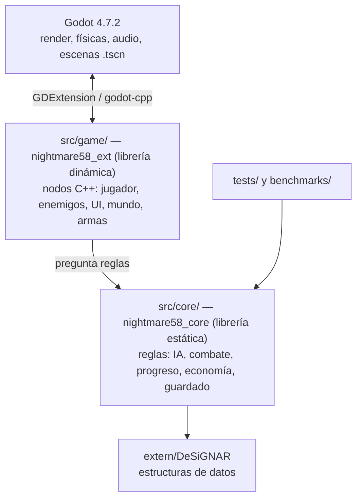
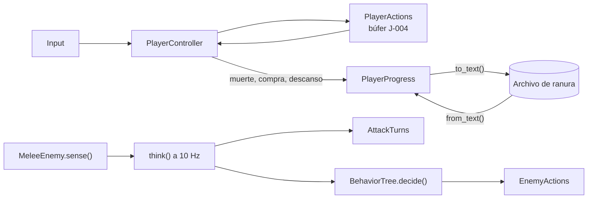
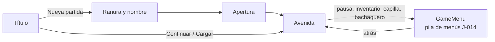

# Nightmare 58: Documento de diseño técnico

| | |
|---|---|
| **Autores** | Juan Daniel Mendoza Sanchez, Juan Enrique Uzcategui Zambrano, Jeison David Hernandez Peraza |
| **Estado** | Vivo: se actualiza al cerrar cada sesión de trabajo relevante |
| **Versión** | 1.1, 2026-11-19 (ver [historial](#c-historial-de-versiones)) |
| **Relacionados** | [PDD](PDD.md) (qué es el juego), [Convenciones](Convenciones.md) (cómo se escribe el código), [Justificaciones](Justificaciones.md) (por qué cada estructura), [guía de arte](art_guide.md), [apertura](opening.md) |

## 1. Introducción y visión general

### 1.1 Resumen

Nightmare 58 es un souls-like 3D low poly en C++17 sobre Godot 4.7.2 (GDExtension).
Es el proyecto de Programación 3: todas las estructuras de datos del juego salen de
DeSiGNAR. La lógica vive en una librería sin Godot que se prueba y mide desde la
terminal; una capa delgada la conecta al motor.

**Alcance de la entrega:** capítulo 1 (apertura, calle caotica, mini-boss Guino y posiblemente llano con El Silbón).
El proyecto continúa después con otros capítulos.

### 1.2 Objetivos y no objetivos

**Objetivos**

- Que las estructuras de datos hagan funcionar el juego, cada una justificada con su
  ficha y, si es crítica, medida.
- Separar reglas (`src/core/`) de motor (`src/game/`) para probar sin abrir Godot.
- Compilar y pasar pruebas en Linux, Windows y macOS en cada pull request.
- Correr en PCs modestas: renderer Compatibility y presupuesto de 16,6 ms por frame.

**No objetivos**

- Contenedores de la STL o `Array`/`Dictionary` de Godot en la lógica.
- GDScript: el juego es solo C++; Python solo en los scripts de Blender de `art/`.
- Capítulos posteriores al 1, finales múltiples, árbol de diálogo.

### 1.3 Contenido y trazabilidad

Este documento explica **cómo está construido** el juego; el diseño de juego vive en
el PDD. Las secciones 1 a 8 siguen el formato de un documento de diseño de software;
los anexos llevan pruebas, el desarrollo por semana y el historial.

Cada decisión se puede rastrear en tres pasos: **requisito** (PDD) → **decisión**
(ficha J-xxx en Justificaciones) → **código** (comentario `// J-xxx:` junto a la
declaración).

## 2. Arquitectura del sistema

**Estilo:** arquitectura en capas. Cada capa solo conoce a la de abajo.

**Decisiones clave y sus costos**

| Decisión | Ganamos | Pagamos |
|---|---|---|
| El núcleo no incluye Godot | Se prueba y mide sin el motor | `src/game/` traduce tipos (`Vector3` ↔ números) |
| Las excepciones de DeSiGNAR se atrapan en `src/game/` | Un error no tumba el editor | Activar excepciones en `godot-cpp` desde CMake |
| Nada reserva memoria por frame en código crítico | Sin tirones | Contenedores fijos con capacidad elegida a mano |
| Enemigos deciden a 10 Hz, no cada frame (J-005) | Costo de IA acotado | Hasta 0,1 s de reacción |
| El arte se genera por script de Blender | Modelos reproducibles y editables | Cada cambio pasa por el script y se reexporta |

## 3. Diseño de datos

### 3.1 Marco teórico: estructuras de DeSiGNAR utilizadas

Cada fila enlaza su ficha en [Justificaciones.md](Justificaciones.md), que tiene
complejidades, alternativas descartadas y mediciones.

| Sistema | Estructura | Por qué, en una línea | Ficha |
|---|---|---|---|
| Árbol de habilidades | `MTreeNode` | Jerarquía real padre-hijos | J-001 |
| IA de enemigos | Árbol de comportamiento sobre `MTreeNode` | DeSiGNAR no lo trae; se guarda en sus nodos | J-002 |
| Rotación de ataques | `DynQueue` | El ataque usado pasa al final, `O(1)` | J-003 |
| Búfer de inputs | `FixedQueue` (2) | FIFO sin reservar memoria por frame | J-004 |
| Turnos de ataque | Contador | Los enemigos no necesitan conocerse | J-006 |
| Catálogo de objetos | `HashMap` + `DynArray` | Clave de texto → `ItemId` → índice `O(1)` | J-007 |
| Cantidades del inventario | `DynArray` por `ItemId` | Acceso directo, sin búsqueda | J-008 |
| Orden del inventario | `merge_sort` | Estable (probado en `test_core`) | J-009 |
| Botín | Pesos acumulados + recorrido lineal | Con `n` pequeño gana a `binary_search` | J-010 |
| Objetos recogidos | `DynBitSet` | Un bit por objeto del mundo | J-012 |
| Objeto rápido | `FixedQueue` (4) | El frente es el objeto en la mano | J-013 |
| Menús anidados | `FixedStack` (4) | Volver atrás recupera pantalla y fila | J-014 |
| Tasa de cambio por día | `binary_search` | Tabla fija ordenada, `O(lg n)` | J-015 |
| Estados alterados | `SLList` | Borrar al recorrer en `O(1)` | J-016 |
| Lock-on | `DynArray` + `insertion_sort` | Pocos objetivos y casi ordenados | Pendiente |
| Combo del jugador | `SLList` | Las mejoras agregan pasos | Pendiente |

Pendientes del PDD sin implementar: heap del jefe, trie del bestiario, `quicksort` de
récords, rastro de enemigos. La lista viva está en
[Justificaciones.md#pendientes](Justificaciones.md#pendientes).

### 3.2 Flujo de datos

### 3.3 Almacenamiento e integridad

- **Partida:** todo el estado persistente está en `PlayerProgress` y se guarda como un
  archivo de texto por ranura. La primera línea es una cabecera con versión; se aceptan
  versiones de la 1 a la actual, así las partidas viejas siguen cargando.
- **Integridad:** `from_text()` lee todo antes de aplicar. Si el archivo está dañado o
  la versión no es válida, la partida en memoria no cambia.
- **Identidad de objetos:** clave de texto en escenas y archivos, `ItemId` (índice) en
  memoria. Así renombrar un objeto en pantalla no rompe partidas.
- **Estado del mundo sin campos nuevos:** los objetos colocados y los portones atajo
  comparten el `DynBitSet` de recogidos.
- **Opciones:** volumen y sensibilidad, en un archivo aparte de las partidas.

## 4. Diseño de interfaces

No hay red ni servicios externos: las interfaces son internas.

| Interfaz | Cómo se comunican |
|---|---|
| Godot ↔ `src/game/` | GDExtension. `register_types.cpp` registra cada clase; las escenas `.tscn` colocan los nodos y fijan sus propiedades exportadas |
| `src/game/` → `src/core/` | Llamadas directas en C++. El juego arma un contexto (por ejemplo `EnemyContext`), el núcleo devuelve una decisión. El núcleo nunca llama al juego |
| Animación → código | `AnimationPlayer` llama métodos del nodo. En la apertura: `cut`, `say`, `send`, `finish` de `OpeningCutscene` ([opening.md](opening.md)) |
| Blender → Godot | `.glb` exportado por script a `game/models/`; los clips se llaman igual que en el código |

**Errores y excepciones**

- DeSiGNAR lanza excepciones; se atrapan en `src/game/` y ninguna llega a Godot.
- Los nodos se liberan con `queue_free()`, nunca con `delete`. Cada puntero tiene un
  dueño claro.
- Un archivo de partida inválido se rechaza sin modificar el estado (§3.3).

**Seguridad:** no aplica; el juego no usa red ni cuentas.

## 5. Diseño de componentes

### 5.1 `src/core/` (reglas)

| Módulo | Recibe | Devuelve | Lógica |
|---|---|---|---|
| `ai/behavior_tree` | `EnemyContext` (distancia, vida, visión, carga) | Acción a ejecutar | Selector para en el primer éxito, Sequence en el primer fallo. `decide()` es puro; `commit()` rota el ataque |
| `ai/enemy_actions` | Acción, tiempo | Estado del enemigo, ventanas de golpe | Tabla de tiempos por ataque y tipo de enemigo |
| `ai/attack_turns` | Pedido de turno | Sí o no | Máx. 2 atacantes, 0,7 s entre ataques |
| `player/player_actions` | Intención del jugador, tiempo | Acción en curso, i-frames, ventana de golpe | Tabla de acciones, búfer de 0,45 s, cancelaciones, estamina |
| `player/rage`, `thrown_weapon` | Golpes dados y recibidos; tiempo y choques | Multiplicadores; posición del machete | Modo Arrechera; ida, regreso y rebote |
| `progression/player_progress` | Eventos: morir, comprar, descansar, aprender | Estado de la partida, texto guardado | Reglas de lochas, inflación, recargo por muertes, recuperación |
| `progression/*` (resto) | Claves, tiradas, días | Objetos, precios, multiplicadores | Catálogo, inventario, botín, inflación, estadísticas, árbol del machete, objeto rápido |
| `health`, `stamina`, `status_effects`, `lock_on`, `menu_stack`, `distance` | | | Piezas pequeñas compartidas |

### 5.2 `src/game/` (motor)

| Carpeta | Clases |
|---|---|
| `player/` | `PlayerController` (`CharacterBody3D`): cámara, movimiento, golpes, lock-on, HUD, guardado |
| `enemies/` | `CombatTarget` (base golpeable) → `MeleeEnemy` (bucle `sense` / `think` / acción) → `SkeletonEnemy`, `RatEnemy`, `DogEnemy`, `GuinoEnemy`; `TrainingDummy` |
| `weapons/` | `ThrownMachete`, `WeaponTrail` |
| `world/` | `Chapel`, `Merchant`, `ShortcutGate`, `LootPickup`, `LostLochas`, `OpeningCutscene`; `save_file` (funciones de guardado) |
| `ui/` | `TitleScreen`, `GameMenu`, `SkillTreeView`, `StatBar`, `ItemSlot`, `FacetPlate`, `KeyButton`; `game_settings` y `ui_sounds` (funciones) |
| `debug/` | `DesignarCheck` (prueba de integración de la fase 0) |

Toda clase nueva se agrega a `CMakeLists.txt` y a `register_types.cpp`.

## 6. Diseño de la interfaz de usuario

El estilo visual (placas de yeso, íconos, fuente) está en
[art_guide.md#interfaz](art_guide.md#interfaz).

- **Menús en juego:** capilla (descansar, subir estadísticas), inventario por pestañas,
  pausa, opciones, tienda y árbol del machete. Volver atrás deja el cursor en la fila
  donde estaba.
- **HUD:** vida con rastro de daño, estamina, Arrechera, objeto rápido, nivel, lochas,
  números de daño y barra de jefe.
- **Controles:** teclado y ratón, y mando en el mapa de entradas de Godot. La interfaz
  responde a hover y click, y a teclado.
- **Accesibilidad:** subtítulos con nombre de quien habla y subtítulos de sonido en
  cursiva; volumen y sensibilidad ajustables; la cinemática se puede saltar.

## 7. Supuestos y dependencias

| Dependencia | Versión | Nota |
|---|---|---|
| Godot | 4.7.2, renderer Compatibility | Misma versión para todo el equipo |
| `godot-cpp` | 10.0.0 (API 4.7) | Submódulo |
| DeSiGNAR | `extern/DeSiGNAR` | Submódulo, no se modifica |
| GCC 9+, CMake 3.20+, Ninja, Python 3 | | MSYS2 UCRT64 en Windows |
| Blender | | Solo para regenerar arte |
| GitHub Actions | `.github/workflows/build.yml` | Compila y prueba en las tres plataformas |

**Supuestos y restricciones**

- Hardware modesto: se prioriza el renderer Compatibility sobre efectos.
- Pocos enemigos activos a la vez; varias estructuras se eligieron para `n` pequeño
  (J-010, lock-on) y habría que revisarlas si eso cambia.
- Cada escena `.tscn` la edita una sola persona a la vez.

**Riesgos**

| Riesgo | Estado y mitigación |
|---|---|
| Compiladores distintos por plataforma | CI en las tres |
| Puntero mal manejado cierra el editor | Probar en el núcleo antes de llevarlo a Godot |
| Alcance grande | Jefe primero; el resto es recortable |
| El arte consume más que el código | Sistemas con placeholders; el arte en su propia tarea |
| `PlayerController` crece (~1400 líneas) | Mover reglas nuevas a `src/core/player/` |

## 8. Glosario

| Término | Significado |
|---|---|
| DeSiGNAR | Librería de estructuras de datos en C++ que usa todo el juego |
| GDExtension | Mecanismo de Godot para cargar clases C++ desde una librería dinámica |
| Núcleo | `src/core/`, lógica sin Godot |
| Crítico | Código que corre cada frame o puede causar un tirón visible |
| Ficha J-xxx | Justificación de una estructura en [Justificaciones.md](Justificaciones.md) |
| i-frames | Momento de una acción, como rodar, en que el jugador no recibe daño |
| Lock-on | Fijar la cámara y los golpes en un enemigo |
| Lochas | Moneda del juego; su precio sube con la inflación |
| Capilla | Punto de control: descansar, subir estadísticas, avanzar el día |
| Bachaquero | Vendedor; precios según la inflación de su zona |
| `.glb` / `.tscn` | Modelo 3D exportado / escena de Godot |

## Anexos

### A. Pruebas y medición

- `tests/test_core.cpp` cubre `src/core/` (`ctest --test-dir build`). Toda lógica nueva
  del núcleo lleva prueba.
- `benchmarks/`: `behavior_tree`, `input_buffer`, `enemy_ai`, `progression`. Se mide en
  Release, contra al menos una alternativa, con tamaño esperado y 10×; resultados en
  la ficha.
- El juego se revisa en Godot por el equipo; cambios pequeños solo exigen compilar y
  `test_core`.

### B. Desarrollo por semana

Una entrada por semana: qué se construyó y qué decisión técnica dejó. El detalle está
en el historial de git.

| Semana | Entregado | Decisiones técnicas |
|---|---|---|
| 1 (26 oct – 1 nov) | Integración Godot + DeSiGNAR, árbol de habilidades, árbol de comportamiento, avenida y protagonista, combate con combo de 3 golpes, esqueleto con IA, base de progreso (inventario, loot, lochas, capillas, guardado), título y pausa | Capa `core`/`game`; J-001 a J-010, J-012 a J-014; `src/game/` en subcarpetas |
| 2 (2 – 8 nov) | Malla de navegación, bachaquero y tienda, inflación, árbol del machete, grasas, lanzar machete, Modo Arrechera, gorra, rata, perro, Güino, ruta a la catedral | J-015, J-016; malla de navegación horneada |
| 3 (9 – 15 nov) | Interfaz "de la calle", HUD pulido, árboles dibujados desde el `MTreeNode`, uso del loot, proporciones del protagonista | J-001 ampliada: la UI recorre el árbol del núcleo |
| 4 (16 – 22 nov) | En curso: cinemática de apertura (Luis, carro, viaje, choque, despertar) | Cinta de calle reciclada en vez de escenario largo; un `AnimationPlayer` dirige el guion |

### C. Historial de versiones

| Versión | Fecha | Cambio |
|---|---|---|
| 1.0 | 2026-11-19 | Primera versión completa |
| 1.1 | 2026-11-19 | Orden de secciones según el formato de documento de diseño; flujo de datos, interfaz de usuario, errores y trazabilidad |

### Cómo mantenerlo

Al terminar una sesión de trabajo relevante (un sistema nuevo, una decisión de
estructura o un cambio de arquitectura):

1. Agregar o actualizar la fila de la semana en el [anexo B](#b-desarrollo-por-semana).
2. Si hubo estructura nueva: ficha en Justificaciones y fila en [§3.1](#31-marco-teórico-estructuras-de-designar-utilizadas).
3. Si hubo clase o módulo nuevo: fila en [§5](#5-diseño-de-componentes).
4. Si cambió el guardado, una pantalla o una dependencia: §3.3, §6 o §7.
5. Subir la versión en el encabezado y en el [anexo C](#c-historial-de-versiones).
6. Pedir a otro integrante que lo revise en el pull request.

Si algo no cambia cómo está construido el juego, no va aquí.
